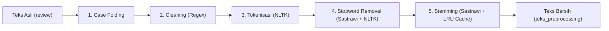

# Tugas SIF301 — Natural Language Processing
## Text Preprocessing pada Dataset Ulasan E-Commerce Berbahasa Indonesia

> Repository ini berisi implementasi eksplorasi data dan *text preprocessing* pada dataset ulasan produk e-commerce berbahasa Indonesia untuk memenuhi tugas mata kuliah **SIF301 - Natural Language Processing**.

---

## Identitas Mahasiswa

| Keterangan | Informasi |
| :--- | :--- |
| **Nama** | Annada Khairatun Nisa |
| **NIM** | 24146038 |
| **Mata Kuliah** | SIF301 - Natural Language Processing |
| **Dataset** | [dipawidia/ecommerce-product-reviews-sentiment](https://huggingface.co/datasets/dipawidia/ecommerce-product-reviews-sentiment) |

---

## Struktur Repository

```text
.
├── Tugas_NLP_Text_Preprocessing.ipynb   # Notebook utama lengkap dengan kode & output eksekusi
├── PENJELASAN_KODE.md                   # Dokumentasi penjelasan kode secara rinci per sel
└── README.md                            # Ringkasan proyek, identitas, dan hasil utama
```

> Untuk penjelasan kode baris demi baris pada setiap sel notebook, lihat [`PENJELASAN_KODE.md`](./PENJELASAN_KODE.md).

---

## Ringkasan Dataset

Dataset dimuat langsung dari Hugging Face (`dipawidia/ecommerce-product-reviews-sentiment`).

| Informasi | Nilai |
| :--- | :--- |
| **Sumber File** | `labeledReview.datasetFix.json` (split `train`) |
| **Total Data** | **11.606** baris ulasan |
| **Jumlah Kolom** | **3** kolom (`review`, `translate`, `sentimen`) |
| **Missing Values** | **0** pada seluruh kolom |
| **Data Duplikat (`review`)** | **7** baris |

### Deskripsi Kolom & Distribusi Label Sentimen

| Kolom | Tipe Data | Deskripsi |
| :--- | :--- | :--- |
| `review` | `object` (string) | Teks ulasan produk berbahasa Indonesia *(digunakan pada preprocessing)* |
| `translate` | `object` (string) | Terjemahan ulasan dalam bahasa Inggris |
| `sentimen` | `int64` | Label sentimen: `0` (Negatif) dan `1` (Positif) |

| Kode Label | Kategori Sentimen | Jumlah Data | Persentase |
| :---: | :--- | :---: | :---: |
| `0` | Negatif (0) | 5.803 | 50,00% |
| `1` | Positif (1) | 5.803 | 50,00% |
| **Total** | | **11.606** | **100,00%** |

Dataset bersifat **seimbang sempurna (balanced)** antara kelas positif dan negatif.

---

## Alur Pipeline Preprocessing



---

## Penjelasan Kode per Bagian (`Tugas_NLP_Text_Preprocessing.ipynb`)

Notebook disusun secara modular menjadi **6 bagian utama** (17 sel) yang dapat dijalankan berurutan dari atas ke bawah.

### Bagian 0 — Instalasi & Import Library (Sel 2–3)
- **Instalasi Dependensi:** Menjalankan `%pip install -q datasets pandas matplotlib nltk Sastrawi` agar notebook dapat dijalankan langsung baik di Google Colab maupun Jupyter lokal.
- **Import & Konfigurasi:**
  - `datasets.load_dataset` untuk mengambil dataset dari Hugging Face Hub.
  - `pandas` & `matplotlib.pyplot` untuk pengolahan tabel dan visualisasi data.
  - `re` untuk pembersihan teks berbasis *regular expression*.
  - `functools.lru_cache` dan `time` untuk optimasi caching *stemming* serta pengukuran waktu eksekusi.
  - `nltk` (`punkt`, `punkt_tab`, `stopwords`) dan `Sastrawi` untuk tokenisasi, *stopword removal*, dan *stemming* Bahasa Indonesia.
  - `pd.set_option("display.max_colwidth", None)` agar isi ulasan panjang tidak terpotong saat ditampilkan.

---

### Bagian 1 — Load Dataset (Sel 5)
```python
dataset = load_dataset("dipawidia/ecommerce-product-reviews-sentiment")
```
- Memuat objek `DatasetDict` dari Hugging Face.
- Melakukan iterasi terhadap seluruh *split* yang tersedia (`dataset.items()`), mengonversinya ke `pandas.DataFrame`, lalu menggabungkannya dengan `pd.concat(..., ignore_index=True)`.
- Menetapkan variabel `TEXT_COL = "review"` dan `LABEL_COL = "sentimen"` secara dinamis agar kode tetap aman terhadap variasi struktur dataset.

---

### Bagian 2 — Eksplorasi Informasi Dataset & Visualisasi (Sel 7–8)
- **Sel 7 (Statistik Umum):** Menampilkan dimensi (`df.shape`), daftar nama kolom, tipe data & memori (`df.info()`), jumlah *missing values* (`df.isnull().sum()`), jumlah ulasan duplikat (`df.duplicated(subset=[TEXT_COL]).sum()`), serta 5 contoh baris pertama (`df.head()`).
- **Sel 8 (Distribusi Sentimen):**
  - Menghitung frekuensi dan persentase masing-masing kelas menggunakan `value_counts()` dan `value_counts(normalize=True)`.
  - Memetakan kode numerik ke label yang mudah dibaca (`0 → Negatif (0)`, `1 → Positif (1)`).
  - Menampilkan visualisasi dua grafik berdampingan (`plt.subplots(1, 2)`): **Bar Chart** (jumlah absolut + anotasi persentase) dan **Pie Chart** (proporsi label sentimen).

---

### Bagian 3 — Implementasi & Eksekusi 5 Tahap Preprocessing (Sel 10–12)

#### 1. Persiapan Kamus Stopword & Stemmer (Sel 10)
- **Stopwords:** Menggabungkan daftar stopword Bahasa Indonesia dari `StopWordRemoverFactory().get_stop_words()` (`Sastrawi`) dan `stopwords.words("indonesian")` (`NLTK`) menggunakan operasi himpunan (`.union()`), menghasilkan **774 kata stopword unik** (`STOPWORDS_ID`).
- **Stemmer + Optimasi Cache:** Membuat stemmer Bahasa Indonesia lewat `StemmerFactory().create_stemmer()` lalu membungkusnya dengan `@lru_cache(maxsize=None)` pada fungsi `stem_kata(kata)`. Setiap kata unik cukup di-stem satu kali lalu hasilnya disimpan di memori — sangat mempercepat proses pada korpus besar.

#### 2. Lima Fungsi Tahapan Preprocessing (Sel 10)

| Tahap | Fungsi | Mekanisme Kerja |
| :---: | :--- | :--- |
| **1** | `case_folding(text)` | Mengubah seluruh karakter ke huruf kecil (`str(text).lower()`) dan menangani nilai `NaN` agar tidak menimbulkan error. |
| **2** | `cleaning(text)` | Menghapus *noise* menggunakan `re.sub`: URL (`https?://\S+\|www\.\S+`), tag HTML (`<.*?>`), mention/hashtag (`[@#]\w+`), angka (`\d+`), tanda baca/emoji/karakter non-alfabet (`[^a-z\s]`), serta merapikan spasi berlebih (`\s+`). |
| **3** | `tokenisasi(text)` | Memecah string kalimat menjadi daftar kata (*list of tokens*) menggunakan `nltk.tokenize.word_tokenize(text)`, dengan *fallback* otomatis ke `text.split()` jika resource `punkt` tidak tersedia. |
| **4** | `stopword_removal(tokens)` | Membuang seluruh token yang terdapat pada `STOPWORDS_ID` serta membuang token sisa pembersihan yang hanya terdiri dari 1 huruf (`len(kata) > 1`). |
| **5** | `stemming(tokens)` | Mengubah setiap kata berimbuhan ke kata dasar Bahasa Indonesia dengan memanggil `stem_kata(kata)`. |

#### 3. Eksekusi Pipeline & Demonstrasi Bertahap (Sel 11–12)
- Setiap tahap disimpan ke kolom tersendiri (`case_folding`, `cleaned`, `tokens`, `no_stopwords`, `stemmed_tokens`) lalu digabung kembali menjadi string bersih pada kolom `teks_preprocessing`.
- **Performa Eksekusi Aktual:** Seluruh **11.606 ulasan** selesai diproses dalam **664,81 detik** (~11 menit) dengan **12.046 kata unik** yang diproses oleh *cache* Sastrawi.
- **Contoh Transformasi Bertahap (Indeks 0):**
  - **0. Teks Asli:** `Suara dan mic puas. Hanya saya pesan yg nyala dan sudah sy pastikan lg klik yg nyala tp yg datang ga nyala`
  - **1. Case Folding:** `suara dan mic puas. hanya saya pesan yg nyala dan sudah sy pastikan lg klik yg nyala tp yg datang ga nyala`
  - **2. Cleaning:** `suara dan mic puas hanya saya pesan yg nyala dan sudah sy pastikan lg klik yg nyala tp yg datang ga nyala`
  - **3. Tokenisasi:** `['suara', 'dan', 'mic', 'puas', 'hanya', 'saya', 'pesan', 'yg', 'nyala', 'dan', 'sudah', 'sy', 'pastikan', 'lg', 'klik', 'yg', 'nyala', 'tp', 'yg', 'datang', 'ga', 'nyala']`
  - **4. Stopword Removal:** `['suara', 'mic', 'puas', 'pesan', 'yg', 'nyala', 'sy', 'pastikan', 'lg', 'klik', 'yg', 'nyala', 'tp', 'yg', 'ga', 'nyala']`
  - **5. Stemming:** `['suara', 'mic', 'puas', 'pesan', 'yg', 'nyala', 'sy', 'pasti', 'lg', 'klik', 'yg', 'nyala', 'tp', 'yg', 'ga', 'nyala']`
  - **Hasil Akhir:** `suara mic puas pesan yg nyala sy pasti lg klik yg nyala tp yg ga nyala`

---

### Bagian 4 — Perbandingan 10 Contoh Sebelum & Sesudah Preprocessing (Sel 14)
- Menggunakan **stratified sampling** (`n=5` untuk setiap kelas sentimen dengan `random_state=42`) agar perbandingan bersifat adil, representatif, dan konsisten saat dijalankan ulang.
- Ditampilkan menggunakan `pandas.DataFrame.style` dengan perataan kiri (`text-align: left`) agar mudah dibaca.

| No | Sentimen | Sebelum Preprocessing | Sesudah Preprocessing |
| :---: | :--- | :--- | :--- |
| 1 | Negatif (0) | …hanya 13 Channel? Mudah2an besok atau minggu depan nambah ya 😄 | `channel mudah an besok minggu nambah` |
| 2 | Negatif (0) | bintang 1 dulu, ini kenapa backlight keyboardnya gak nyala ya ? pakai batre lagi? | `bintang backlight keyboardnya gak nyala pakai batre` |
| 3 | Negatif (0) | Pengiriman cepat kemarin pesan, skrng sudah datang, Kualitas bagus sesuai harga, cuma klik tombol forward n back nya terlalu dalam n kyk tertukar gk sesuai di buku petunjuk, tapi mantaap mouse seri terbarunya, sblmnya pke yg Fantech Raigor W4 semoga awet kyk seri sblm nya.. | `kirim cepat kemarin pesan skrng kualitas bagus sesuai harga klik tombol forward back nya kyk tukar gk sesuai buku tunjuk mantaap mouse seri baru sblmnya pke yg fantech raigor moga awet kyk seri sblm nya` |
| 4 | Negatif (0) | Harga:Lumayan<br>Bahan/Material:Bagus<br>Kegunaan:membantu<br>Sebenernya dari bahan itu good bgt, gx ada keluhan sama skli, cuman dus nya aja terlalu sempit udh gtu gx di ksoh skat per spatula, jdi kegesek2 jdi ada yg baret/lecet, si cantolan rak nya pdhal jgn di psng drsnanya, jdi ada yg patah, mungkin krna packing nya jga terlalu tipis, buble+plastik doang | `harga lumayan bahan material bagus guna bantu sebenernya bahan good bgt gx keluh skli cuman dus nya aja sempit udh gtu gx ksoh skat spatula jdi gesek jdi yg baret lecet si cantol rak nya pdhal jgn psng drsnanya jdi yg patah krna packing nya jga tipis buble plastik doang` |
| 5 | Negatif (0) | komunikasi merupakan suatu hal yang penting dalam kehidupan mahluk hidup, salah satunya yaitu manusia. Tanpa komunikasi, dapat dikatakan manusia tidak layak hidup. Karena tidak ada komunikasi baik pada diri sendiri apalagi orang lain. Oleh sebab itu komunikasi begitu penting dan wajib dilakukan. | `komunikasi hidup mahluk hidup salah satu manusia komunikasi manusia layak hidup komunikasi orang komunikasi wajib` |
| 6 | Positif (1) | Pengiriman standar, packing standar kardusnya, overall bagus pengiriman. | `kirim standar packing standar kardus overall bagus kirim` |
| 7 | Positif (1) | Alhamdulillah barang sudah sampai dengan selamat, tidak ada yang cacat atau penyok, sesuai etalase dan diskripsi asli merk Maspion SNI, toko amanah seller ramah kurirnya baru.. semoga toko sukses 👍👍 | `alhamdulillah barang selamat cacat penyok sesuai etalase skripsi asli merk maspion sni toko amanah seller ramah kurir moga toko sukses` |
| 8 | Positif (1) | barang bagus dan packing nya sangat bagus terbaik👍 | `barang bagus packing nya bagus baik` |
| 9 | Positif (1) | pelayanan sangat cepat. order pagi, sore sampai. | `layan cepat order pagi sore` |
| 10 | Positif (1) | mantabhh | `mantabhh` |

---

### Bagian 5 — Evaluasi Kuantitatif & Pengaruh Preprocessing (Sel 15–16)

Sel 15 menghitung perbandingan jumlah token, rata-rata panjang ulasan, dan ukuran kosakata unik (*vocabulary size*) sebelum dan sesudah preprocessing:

| Metrik | Sebelum Preprocessing | Sesudah Preprocessing | Reduksi |
| :--- | :---: | :---: | :---: |
| **Total Token (Kata)** | 182.871 | 128.111 | **-29,94%** |
| **Rata-rata Kata per Ulasan** | 15,76 | 11,04 | **-29,94%** |
| **Jumlah Kosakata Unik (*Vocabulary Size*)** | 26.205 | 10.034 | **-61,71%** |

#### Kesimpulan Pengaruh Preprocessing terhadap Kualitas Data Teks
1. **Reduksi Dimensi Kosakata Signifikan (-61,71%):** Gabungan *case folding*, *cleaning*, *stopword removal*, dan *stemming* memangkas kosakata unik dari **26.205** menjadi **10.034** kata. Fitur teks menjadi jauh lebih padat (*less sparse*), efisien untuk ekstraksi fitur (TF-IDF / BoW), dan menekan risiko *overfitting*.
2. **Pembersihan *Noise* Efektif:** Emoji (`😄`, `👍`), angka (`13`, `W4`), tanda baca berlebih (`..`, `?`), serta karakter khusus berhasil dihapus sepenuhnya.
3. **Penyeragaman Kata Berimbuhan:** Kata seperti `"Pengiriman"` → `"kirim"`, `"pelayanan"` → `"layan"`, `"keluhan"` → `"keluh"`, dan `"tertukar"` → `"tukar"` berhasil dinormalisasi ke bentuk dasarnya.
4. **Temuan Keterbatasan (Catatan untuk Pengembangan Lanjutan):**
   - **Hilangnya Kata Negasi:** Pada sampel ke-7, frasa `"tidak ada yang cacat atau penyok"` berubah menjadi `"cacat penyok"` karena `"tidak"` masuk daftar *stopword* standar — pada pemodelan sentimen lanjutan, kata negasi (`tidak`, `bukan`, `kurang`, `gak`) sebaiknya dikecualikan dari *stopword*.
   - **Bahasa Non-Baku / Singkatan (*Slang*):** Kata khas e-commerce seperti `"yg"`, `"skrng"`, `"bgt"`, `"sblmnya"`, `"mantabhh"` masih tersisa dan dapat dinormalisasi lebih lanjut menggunakan kamus *slang*.
   - **Kasus *Over-stemming* pada Typo:** Pada sampel ke-7, kata salah ketik `"diskripsi"` (seharusnya `"deskripsi"`) dipotong imbuhan `"di-"` oleh stemmer menjadi `"skripsi"`.

---

## Cara Menjalankan Notebook

### 1. Melalui Google Colab (Direkomendasikan)
1. Buka [Google Colab](https://colab.research.google.com/).
2. Pilih **File → Upload notebook** dan unggah `Tugas_NLP_Text_Preprocessing.ipynb`.
3. Klik **Runtime → Run all** (`Ctrl + F9`). Sel pertama akan memasang seluruh dependensi secara otomatis.

### 2. Secara Lokal (Jupyter Notebook / VS Code)
1. Pastikan Python 3.9+ telah terpasang.
2. Instal dependensi yang diperlukan:
   ```bash
   pip install datasets pandas matplotlib nltk Sastrawi jupyter
   ```
3. Jalankan Jupyter Notebook atau buka langsung di VS Code:
   ```bash
   jupyter notebook Tugas_NLP_Text_Preprocessing.ipynb
   ```
4. Jalankan seluruh sel secara berurutan (**Run All**).
